# 토큰 계기판 (Claude Usage Clock)

Claude Code의 5시간 한도, 주간 한도, 대화 크기를 바탕화면 위 기계식 시계로 보여 줍니다. `/usage`를 치지 않아도 바늘 위치로 남은 양이 보입니다.

[English](README.md)

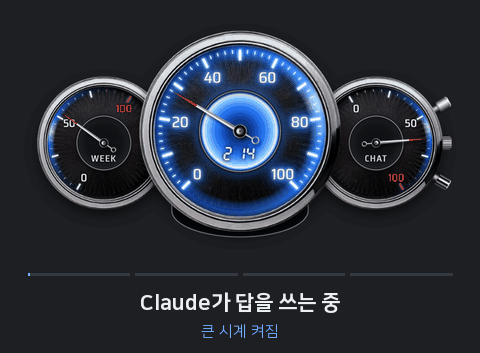

- **토큰을 쓰지 않습니다.** 시계는 모델을 부르지 않고, 모드가 적는 작은 파일만 읽습니다.
- **컴퓨터 밖으로 나가는 것이 없습니다.** 받는 것은 처음 한 번, 시계 자신의 부품뿐입니다.
- **Windows 10 이상.** 맥과 리눅스는 이슈로 관리합니다(아래 표).

## 나에게 필요한가요?

| Claude를 쓰는 곳 | 시계를 쓸 수 있나 |
|---|---|
| Windows의 Claude Code(데스크톱 앱 · 터미널 · IDE) | 됩니다. 파이썬이 없어도 됩니다 |
| 맥이나 리눅스의 Claude Code | 아직 안 됩니다. [플랫폼 이슈](../../issues?q=label%3Aplatform)에 👍를 눌러 주세요 |
| OpenAI 코덱스(Codex) | 아직 안 됩니다. 시계는 Claude Code가 적는 자료만 읽습니다. [플랫폼 이슈](../../issues?q=label%3Aplatform)의 코덱스 이슈에 👍를 눌러 주세요 |
| 브라우저의 claude.ai나 휴대폰 앱만 | 필요 없습니다. 시계는 Claude Code만 적는 자료를 읽습니다 |

## 설치

| 어디서 쓰나 | 이렇게 깝니다 |
|---|---|
| 터미널(`claude`) | 입력창에 아래 한 줄 → `y` → Enter |
| Claude 데스크톱 앱(Code 탭), VS Code 확장 | Claude에게 `https://github.com/octooking-byte/claude-usage-clock 깔아줘`라고 보내고, Claude가 돌리는 명령을 허락한 뒤 새 세션을 엽니다 |

**이 저장소를 누군가에게 깔아 주는 Claude라면** [INSTALL.md](INSTALL.md)를 따르세요.

터미널에 넣을 한 줄:

```
/plugin install token-usage-clock --marketplace octooking-byte/claude-usage-clock
```

끝입니다. 처음 한 번은 모드가 시계를 스스로 준비하고(1분쯤) 바탕화면에 시계가 뜹니다. 안 뜨면 `/clock`을 입력합니다.

<details>
<summary>다른 설치 방법</summary>

- v2.1.275보다 옛 Claude Code, 셸에서:
  ```
  claude plugin marketplace add octooking-byte/claude-usage-clock
  claude plugin install token-usage-clock@token-usage-clock
  ```
- 처음 준비가 하는 일: 파이썬 3이 있으면 `numpy` · `pillow`를 깝니다(`py -3 -m pip install --user numpy pillow`). 없으면 이 저장소 [Releases](../../releases)의 `token-clock-windows.zip`을 받아 SHA-256 지문을 맞춰 본 뒤 `%LOCALAPPDATA%\TokenClock\`에 풉니다. 둘 다 손으로 해도 됩니다.
</details>

## 시계 읽는 법

시계 셋, 빛 둘. 평소에는 이것만 알면 됩니다.

| 시계 | 보여 주는 것 | 시계 밑 경고등이 켜지는 때 |
|---|---|---|
| **5H**(가운데 큰 시계) | 5시간 한도를 쓴 비율. 가운데 숫자는 5시간 한도가 초기화될 때까지 남은 시간 | 80% 이상 쓰면 켜집니다. 남은 시간이 30분 밑이면 숫자도 붉어집니다 |
| **WEEK**(주간) | 7일 주간 한도를 쓴 비율 | 80% 이상 쓰면 켜집니다 |
| **CHAT**(대화) | 지금 대화가 Claude가 한 번에 기억할 수 있는 양(컨텍스트 창)의 몇 %까지 찼는지 | 80% 이상 차면 켜집니다. 곧 압축이 필요하다는 뜻입니다 |

**빛 읽기**: 시계는 Claude가 지금 무엇을 하는지 빛으로 알려 줍니다. 창을 보지 않아도 내 차례인지 알 수 있습니다. 맨 위 GIF가 네 경우를 차례로 보여 줍니다.

| 빛 | 뜻 |
|---|---|
| 큰 시계가 켜짐 | 메인 Claude 창(시계가 따라가는 세션)에서 답을 만드는 중. 또는 내가 그 시계를 누르거나 길게 누르고 있을 때(어느 시계든 누르는 동안 켜집니다) |
| 큰 시계가 깜빡임 | 메인 Claude 창의 허락 창이나 질문 창이 나를 기다림 |
| CHAT 시계가 켜짐 | 메인 Claude 창에서 백그라운드 작업(에이전트 · 워크플로 · 모니터)이 도는 중 |
| 두 시계가 함께 켜짐 | 답을 만드는 중이면서 백그라운드 작업도 도는 중. 두 빛은 따로 켜지고 꺼집니다 |

한도가 초기화되면 바늘이 끝까지 치솟았다가 새 값에 내려앉고 푸른 빛이 번집니다.

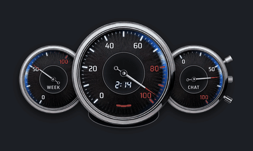

## 시계는 내 세션을 어떻게 찾아가나요?

Claude Code 창(세션)을 여러 개 열어도 시계는 하나입니다. 시계는 그중 한 세션을 「메인 세션」으로 삼아 따라갑니다.

| 언제 | 시계가 하는 일 |
|---|---|
| 어떤 세션에 내가 말을 걸 때 | 그 세션이 메인 세션이 됩니다 |
| 어떤 세션의 허락 창이나 질문 창에 내가 답할 때 | 그 세션이 메인 세션이 됩니다 |
| 자동으로 이어지는 입력(예약 작업 · 프로그램이 보낸 입력) | 메인 세션을 바꾸지 않습니다. 내가 직접 한 말과 답만 셉니다 |
| 메인 세션을 닫을 때 | 메인 자리가 비고, 10초 뒤 아직 열려 있는 세션이 이어받습니다 |

- **5H · WEEK**는 계정 전체 값이라 어느 세션을 따라가든 같습니다.
- **CHAT 바늘 · 빛 · 깜빡임 · 용두 압축**은 메인 세션의 것입니다.
- 다른 세션을 보고 싶으면 그 세션에서 말을 한 번 걸면 됩니다.
- 시계는 Claude Code를 닫아도 바탕화면에 남습니다. 다음에 세션이 열리면 다시 이어집니다.

## 배치 · 흑백 · 빛 색

시계 형태는 두 가지입니다. **단일 시계**(큰 시계 하나 안에 작은 WEEK · CHAT 시계)와 **계기판**(시계 세 개를 나란히)입니다. 우클릭으로 서로 바꾸고, 맨 위 기둥을 누르면 검은 시계와 흰 시계가 바뀝니다.

| | 검은 시계 | 흰 시계 |
|---|---|---|
| **계기판** | 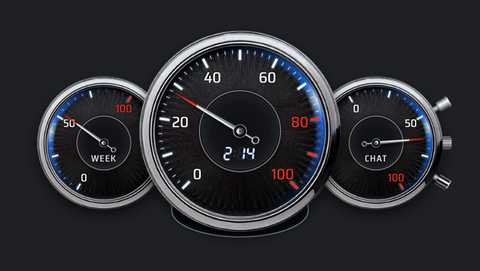 | 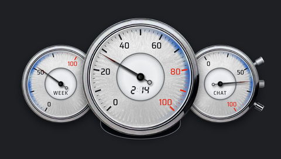 |
| **단일 시계** | 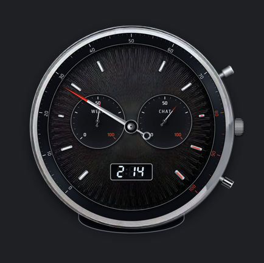 | 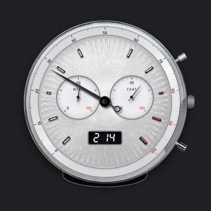 |

**우클릭으로 형태 바꾸기**: 작은 시계 둘이 큰 시계 안으로 들어가 단일 시계가 되고, 다시 누르면 계기판으로 갈라집니다.

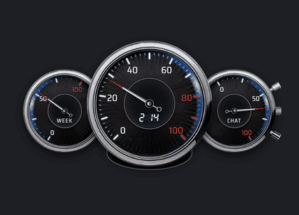

**용두로 빛 색 바꾸기**: 용두를 잡고 마우스를 위아래로 움직이면 검정부터 빨강, 초록, 파랑을 지나 흰색까지 빛 색이 이어서 바뀝니다.

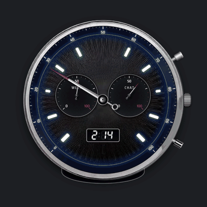

고른 색 다섯 가지 예:

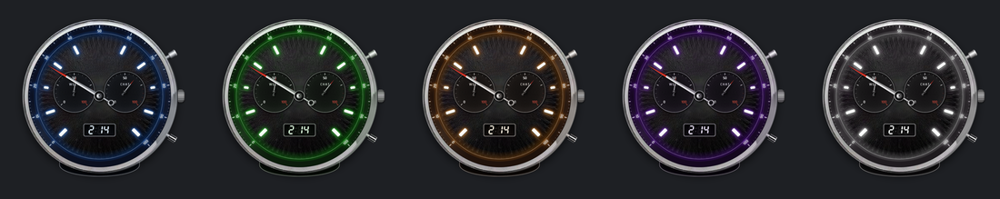

## 조작

시계 오른쪽에는 기둥이 셋 있습니다. 맨 위 기둥, 가운데 용두, 맨 아래 기둥입니다.

**매일 쓰는 것**

| 이렇게 하면 | 일어나는 일 |
|---|---|
| 은색 테를 끌기(단일 시계: 눈금 40~60 사이 · 계기판: 가운데 큰 시계의 테) | 시계를 옮깁니다 |
| 우클릭 | 시계 형태가 바뀝니다. 단일 시계 ↔ 계기판 |
| Shift + 우클릭, 또는 `/clock off` | 시계를 끕니다(다음에도 꺼진 채) |
| `/clock` | 다시 켭니다 |
| 기둥 셋 중 맨 아래 기둥 위에서 휠 | 크기 60~140% |
| 시계 밑 초승달을 아래로 끌기, 또는 큰 시계 더블 클릭 | 작은 화면(액정)이 열리고 닫힙니다. 아래 표 |

**작은 화면(액정)에 나오는 것**

| 줄 | 뜻 | 예 |
|---|---|---|
| **WEEK** | 주간 한도가 초기화될 때까지 남은 시간 | `3일 06시간` |
| **CHAT** | 지금 대화의 크기. Claude가 이 대화에서 기억하고 있는 토큰 수 | `64.0만` = 64만 토큰 |
| **TURN** | 이번 턴(내 말 하나에 Claude가 답하는 동안)에 새로 쓴 토큰. 답이 끝났으면 바로 앞 턴 값. 캐시에서 다시 읽은 양은 빼고 셉니다 | `1.2만` = 1만 2천 토큰 |

영어 윈도우에서는 `3d 06h`, `640k`, `12.0k`처럼 나옵니다.

**더 해 볼 것**

| 이렇게 하면 | 일어나는 일 |
|---|---|
| 맨 위 기둥 누르기 | 검은 시계와 흰 시계가 바뀝니다 |
| 용두를 잡고 마우스를 위아래로 움직이기 | 빛 색이 바뀝니다. 원래 파랑에서 살짝 걸립니다 |
| 용두를 바깥으로 빼고 6초 버틴 뒤 놓기 | 메인 세션의 대화를 압축합니다. 먼저 놓으면 취소 |
| 시계 위에서 휠 굴리기 | 시계의 침이 점점 빠르게 돌아갑니다. 위로 굴려도 아래로 굴려도 됩니다. 도는 중에 반대로 굴리면 버티다가 거꾸로 돕니다 |
| 시계를 누르거나 길게 누르기 | 그 시계의 푸른 빛이 켜집니다 |
| 시계 안쪽을 돌려 감았다 놓기 | 감은 만큼 돌다가 제 값으로 돌아옵니다 |
| 시계 안쪽을 짧게 튕기기 | 돌다가 지금 값에서 멈춥니다 |
| 나머지 테 돌리기(단일 시계) | 피젯스피너처럼 시계가 돕니다 |
| 작은 시계의 테 돌리기(계기판) | 작은 시계 둘이 가운데 큰 시계 둘레를 돕니다 |

**휠로 침 돌리기**: 단일 시계와 계기판 모두, 휠을 굴리는 시계의 침이 점점 빨라집니다.

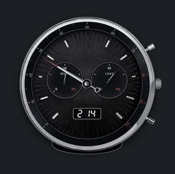 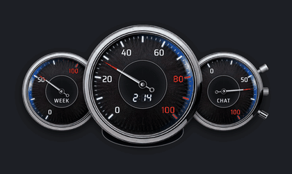

**용두로 CHAT 초기화(대화 압축)**: 용두를 잡아 빼고 버티면 CHAT 시계가 붉게 차오릅니다. 6초를 채우고 놓으면 메인 세션의 대화가 압축되고, CHAT 바늘이 푸른 빛과 함께 되감겨 0 근처로 내려옵니다. 6초 전에 놓으면 취소됩니다.

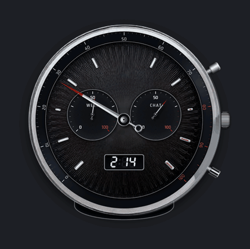

위치 · 크기 · 배치 · 빛 색 · 흑백은 다음 실행 때 그대로 열립니다.

## 문제가 생기면

| 증상 | 해결 |
|---|---|
| 시계가 뜨지 않습니다 | `/clock`을 입력합니다. 처음에는 준비에 1분쯤 걸립니다. 못 띄우면 알림이 뜨고, 까닭은 `%USERPROFILE%\.claude\progress\token-panel-start.log`에 남습니다 |
| 바늘이 움직이지 않습니다 | 모드가 켜져 있는지 봅니다. 한 시간 넘게 값이 오지 않으면 시계가 흐려집니다 |
| Claude가 일하는데 빛이 없습니다 | 모드를 넣거나 바꿨다면 Claude Code를 완전히 종료한 뒤 다시 켭니다 |
| 도는 작업이 없는데 CHAT 빛이 켜져 있습니다 | `%USERPROFILE%\.claude\progress\token-panel.json`의 `backgroundTasks`에 그 작업이 남습니다. 작업이 끝나면 다음 답이 끝날 때 꺼집니다 |
| 시계가 화면 밖으로 나갔습니다 | 껐다 켭니다. 그래도 안 보이면 끈 뒤 `%USERPROFILE%\.claude\progress\token-panel-pos.json`을 지우고 켭니다 |
| 용두를 당겨도 압축되지 않습니다 | 메인 세션만 압축합니다. 그 세션에서 말을 한 번 건 뒤 다시 당깁니다 |
| 그 밖에 이상합니다 | `%USERPROFILE%\.claude\progress\token-panel-error.log`를 [버그 신고](../../issues/new/choose)에 붙입니다 |

## 동작 방식

모드(`hooks/register.tsx`)가 Claude Code 안에서 사용량과 상태를 `~/.claude/progress/token-panel.json`에 적습니다. 시계(`window/`)는 따로 도는 파이썬 창으로, 그 파일만 읽고 NumPy와 Pillow로 그림을 그립니다. 가만히 있을 때 CPU 코어 하나의 1% 미만, 메모리 약 115MB를 씁니다.

모드가 실행하는 것은 이것뿐입니다: 시계(`py -3 window/launch.py`, 파이썬이 없으면 `token-clock.exe`), 한국어 · 영어를 고르려고 세션마다 한 번 `reg query HKCU\Control Panel\International /v LocaleName`, 용두를 당겼을 때 메인 세션의 `/compact`. 시계가 뜨지 못할 때만 한 번: `pip install --user numpy pillow`, 또는 PowerShell로 이 저장소 Releases의 `token-clock-windows.zip`을 받고 `hooks/register.tsx`에 적힌 SHA-256과 같을 때만 남깁니다. 파일은 `~/.claude/progress/` 안에서만 읽고 씁니다(그 받기만 `%LOCALAPPDATA%\TokenClock\`). 사용자나 사용량에 관한 것은 어디로도 보내지 않습니다.

모드에는 `token-usage-clock` 스킬도 들어 있어, 빛이 무슨 뜻인지나 시계가 왜 안 뜨는지 Claude에게 물어볼 수 있습니다.

## 언어

작은 화면과 `/tokens` 패널은 한국어 윈도우에서 한국어(일 · 시간 · 만), 그 밖에서는 영어(`d` · `h` · `k`)입니다. 환경 변수 `TOKEN_PANEL_LANG`을 `ko`나 `en`으로 두면 정할 수 있습니다.

## 라이선스

코드는 [MIT](LICENSE)입니다. 시계 그림(이미지와 시계판 디자인)은 복제하거나 다시 쓸 수 없습니다. [LICENSE-DESIGN.md](LICENSE-DESIGN.md)를 보세요.
