# Token Panel

A desktop mechanical clock for Claude Code. It shows how much of your 5-hour limit, weekly limit and conversation you have used, so you can read it at a glance instead of running `/usage`.

[한국어](README.ko.md)

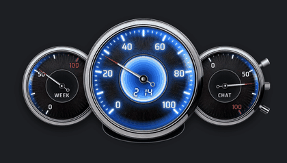

- **No tokens.** The clock never calls a model. It reads a small file the mod writes.
- **No network.** Nothing leaves your computer.
- **Windows 10 or later.** macOS and Linux are tracked in issues (see below).

## Do you need it?

| You use Claude through | Can you use the clock? |
|---|---|
| Claude Code on Windows (desktop app, terminal or IDE) **with** Python 3 | Yes. Install the mod and two Python packages. |
| Claude Code on Windows **without** Python | Yes. Install the mod and the ready-made clock from Releases. |
| Claude Code on macOS or Linux | Not yet. Up-vote the [platform issues](../../issues?q=label%3Aplatform). |
| OpenAI Codex | Not yet. The clock reads data that only Claude Code writes. Up-vote the Codex issue among the [platform issues](../../issues?q=label%3Aplatform). |
| claude.ai in a browser, or the phone app | You do not need it. The clock reads data that only Claude Code writes. |

## Install

**1. Add the mod.** In a terminal session of Claude Code:

```
/plugin install token-panel --marketplace octooking-byte/token-panel
```

Answer `y` to add the marketplace, then pick a scope. This one-line form needs Claude Code v2.1.275 or later. On an older version, run these two lines in your shell instead:

```
claude plugin marketplace add octooking-byte/token-panel
claude plugin install token-panel@token-panel
```

In the desktop app, where `/plugin` does not run: click **+** next to the prompt box → **Plugins** → **Add marketplace** `octooking-byte/token-panel` → **Add plugin**.

**2. Give the clock something to run on.** Pick one.

| | Steps |
|---|---|
| I have Python 3 | `py -3 -m pip install numpy pillow` |
| I do not have Python | Download `token-clock-windows.zip` from [Releases](../../releases) and unzip it into `%LOCALAPPDATA%\TokenClock\`. Each release lists its antivirus scan result. |

**3. Restart Claude Code.** In the desktop app, quit it from the tray icon (closing the window is not enough), then open it again. The clock appears when a session starts.

## Reading the clock

Three dials, two lights. That is all you need day to day.

| Dial | Shows | Warning light under the dial comes on when |
|---|---|---|
| **5H** (the big centre dial) | Share of the 5-hour limit used. The digits in the middle are the time left until the 5-hour limit resets | 80% used. The digits also turn red under 30 minutes |
| **WEEK** | Share of the 7-day weekly limit used | 80% used |
| **CHAT** | How much of Claude's context window (what it can hold in one conversation) the current conversation fills | 80% full, a sign the conversation will soon need compacting |

| Light | Means |
|---|---|
| Big dial glows | Claude is writing an answer in the main Claude window (the session the clock follows). It also glows while you press or hold any dial |
| Big dial blinks | A permission prompt or a question in the main Claude window is waiting for you |
| CHAT dial glows | A background task (agent, workflow, monitor) is running in the main Claude window |

When a limit resets, the hand swings to the top, settles on the new value and a blue ring spreads.

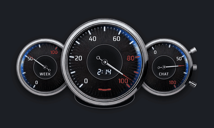

## How does the clock find your session?

You can open many Claude Code windows (sessions); there is still one clock. It follows one of them, the **main session**.

| When | What the clock does |
|---|---|
| You type in a session | That session becomes the main session |
| You answer a permission prompt or question in a session | That session becomes the main session |
| Input that is not yours (scheduled tasks, input sent by a program) | Does not change the main session. Only what you type or answer counts |
| You close the main session | The main slot empties; after 10 seconds a session that is still open takes over |

- **5H and WEEK** are account-wide, so they are the same whichever session the clock follows.
- **The CHAT hand, the lights, the blinking and crown compaction** belong to the main session.
- To look at another session, type once in it.
- The clock stays on the desktop after Claude Code closes, and picks up again when a session opens.

## Layouts, faces and glow colours

The clock has two forms: **single clock** (one big dial with small WEEK and CHAT dials inside) and **dashboard** (three dials side by side). Right-click to switch between them. Click the top stem to switch between a black and a white face.

| | Black face | White face |
|---|---|---|
| **Dashboard** | 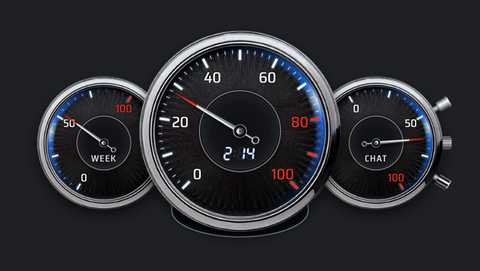 | 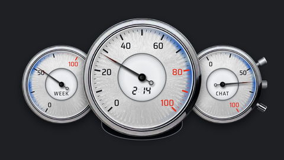 |
| **Single clock** | 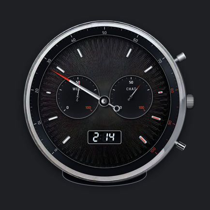 | 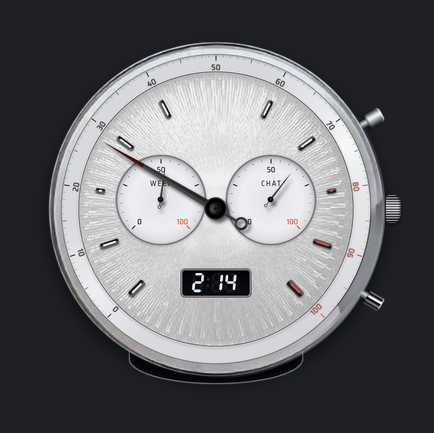 |

**Right-click to change form.** The two small dials slide into the big one to make the single clock; right-click again and they split back into the dashboard.

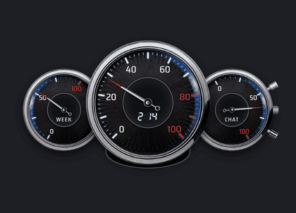

**Change the glow colour with the crown.** Grab the crown and move the mouse up or down; the glow runs from black through red, green and blue to white.

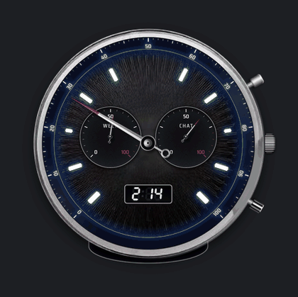

Five colours picked this way:

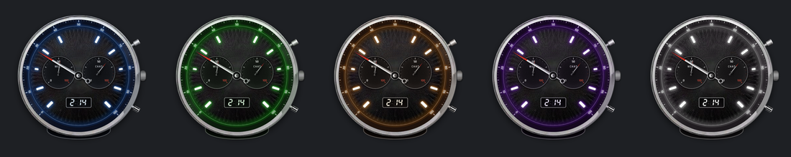

## Controls

On the right of the clock there are three stems: the top stem, the crown in the middle, and the bottom stem.

**Everyday**

| Do this | What happens |
|---|---|
| Drag the silver rim (single clock: the part between 40 and 60; dashboard: the rim of the big centre dial) | Move the clock |
| Right-click | Change the clock's form: single clock ↔ dashboard |
| Shift + right-click, or `/clock off` | Hide the clock (it stays hidden next time) |
| `/clock` | Show it again |
| Scroll over the bottom of the three stems | Resize, 60% to 140% |
| Drag the crescent under the clock down, or double-click the big dial | Open or close the small screen (below) |

**The small screen**

| Row | Means | Example |
|---|---|---|
| **WEEK** | Time left until the weekly limit resets | `3d 06h` |
| **CHAT** | Size of the current conversation: the tokens Claude is holding for it | `640k` = 640,000 tokens |
| **TURN** | New tokens used this turn (while Claude answers one message of yours), or the previous turn once the answer ends. Cache reads are not counted | `12.0k` = 12,000 tokens |

On a Korean Windows the units read 일 · 시간 · 만.

**Extras**

| Do this | What happens |
|---|---|
| Click the top stem | Black or white clock face |
| Grab the crown and move the mouse up or down | Change the glow colour. It clicks into place at the original blue |
| Pull the crown outward, hold 6 seconds, release | Compact the main session's conversation. Release early to cancel |
| Scroll over a dial | The hand spins faster and faster. Scroll up or down, both work. Scroll the other way while it spins and it resists, then reverses |
| Press or hold a dial | That dial's blue light comes on |
| Wind the inside of a dial, then let go | The hand spins off the stored energy and returns to its value |
| Flick inside a dial | The hand spins and stops at the current value |
| Turn the rest of the rim (single clock) | The clock spins like a fidget spinner |
| Turn the rim of a small dial (dashboard) | The two small dials orbit the big centre dial |

**Spin the hands with the wheel.** On the single clock and on every dashboard dial, the hand you scroll over speeds up more and more.

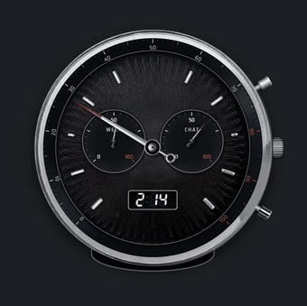 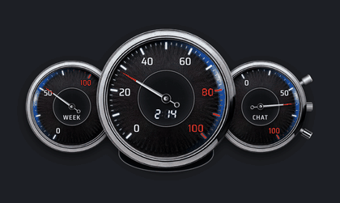

**Reset CHAT with the crown (compact the conversation).** Pull the crown out and hold: the CHAT dial fills red. After 6 seconds, release; the main session's conversation is compacted and the CHAT hand rewinds to near zero with a blue glow. Release before 6 seconds to cancel.

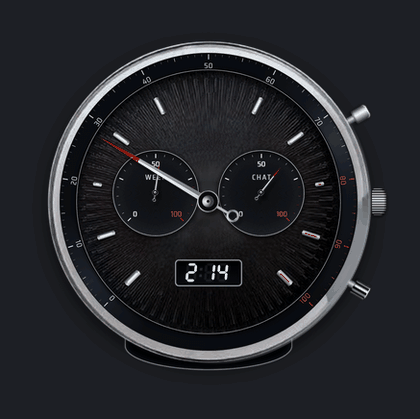

Position, size, layout, colour and face are remembered.

## Troubleshooting

| Problem | Fix |
|---|---|
| The clock does not appear | Check step 2, then type `/clock`. A notice tells you if the clock could not start. |
| Hands do not move | Make sure the mod is enabled. The clock fades if no data arrives for an hour. |
| No glow while Claude works | After installing or updating the mod, fully quit and restart Claude Code. |
| CHAT glows with nothing running | `%USERPROFILE%\.claude\progress\token-panel.json` lists the task under `backgroundTasks`. The light goes out after the next answer once that task ends. |
| The clock is off-screen | Hide and show it again. If it is still lost, hide it, delete `%USERPROFILE%\.claude\progress\token-panel-pos.json`, and show it. |
| Pulling the crown does nothing | It compacts only the main session. Type once in the session you want, then pull again. |
| Something else looks wrong | Attach `%USERPROFILE%\.claude\progress\token-panel-error.log` to a [bug report](../../issues/new/choose). |

## How it works

The mod (`hooks/register.tsx`) runs inside Claude Code and writes usage and status to `~/.claude/progress/token-panel.json`. The clock (`window/`) is a separate Python window that reads that file and draws each frame with NumPy and Pillow. It uses well under 1% of one CPU core while idle and about 115 MB of memory.

The plugin also adds a `token-panel` skill, so you can ask Claude what a light means or why the clock does not appear.

## Language

The small screen and the `/tokens` pane are in Korean on a Korean Windows and in English (`d`, `h`, `k`) everywhere else. Set the environment variable `TOKEN_PANEL_LANG` to `en` or `ko` to choose.

## License

Code: [MIT](LICENSE). The clock artwork (images and dial designs) may not be copied or reused; see [LICENSE-DESIGN.md](LICENSE-DESIGN.md).
